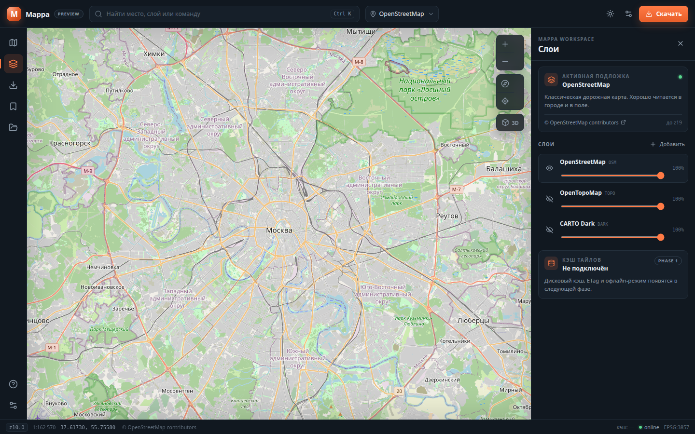
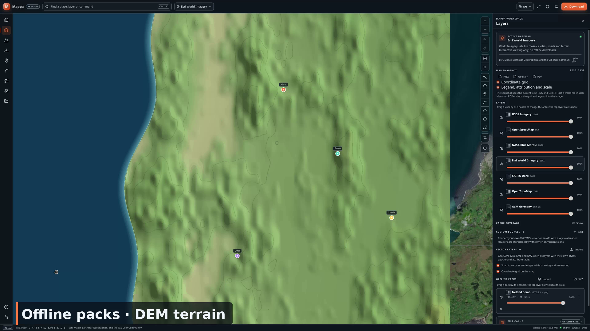

# Mappa

[](https://github.com/vssfeo/mappa/actions/workflows/ci.yml)
[](https://github.com/vssfeo/mappa/releases)

**Рабочее название:** Mappa  
**Статус:** 1.0 release candidate — офлайн-карты, паки, полевая геодезия  
**Дата:** 2026-10-25

Mappa — Linux-first рабочая станция для офлайн-карт и спутниковых снимков.
Не «порт SAS.Planet», а современный продукт: GPU-рендеринг, мгновенный
поиск, нормальный download-менеджер, офлайн-паки, CLI, локальный
tile-server и интеграция с роботами/полевыми устройствами.



[](docs/media/mappa-demo.mp4)

Демо-видео — 2 минуты 52 секунды, английская озвучка: карта, слои,
офлайн-паки, DEM, объекты, радиолинк, геореференсинг, миссия для
QGroundControl, телеметрия MAVLink и полевой режим. Разбор по сценам —
[docs/DEMO.md](docs/DEMO.md). Файл:
[docs/media/mappa-demo.mp4](docs/media/mappa-demo.mp4).

Смотреть: [YouTube](https://youtu.be/oAHpoKXrPpE) ·
[MP4 в релизе](https://github.com/vssfeo/mappa/releases/download/v1.5.1/mappa-demo.mp4) ·
[субтитры EN/RU](docs/media/mappa-demo.srt).

## Документы

| Файл | Что внутри |
|---|---|
| [docs/TZ.md](docs/TZ.md) | техническое задание: функции, требования, архитектура, форматы, качество |
| [docs/UX.md](docs/UX.md) | UI/UX-концепция: экран, сценарии, дизайн-система, клавиатура, состояния |
| [docs/ROADMAP.md](docs/ROADMAP.md) | дорожная карта по фазам, milestone'ы, критерии приёмки, риски |
| [docs/COMPETITORS.md](docs/COMPETITORS.md) | разбор функций SAS.Planet, QGIS, MapTiler, Felt, QGC, CalTopo и полевых приложений, приоритетный бэклог |
| [docs/STATUS.md](docs/STATUS.md) | что уже сделано, чем заблокировано, как запустить |
| [docs/API.md](docs/API.md) | `mappa serve`: tile-server, REST, QGIS/MapLibre, токен |
| [docs/BATCH.md](docs/BATCH.md) | batch JSON jobs, идемпотентность, JSON-вывод CLI |
| [docs/GEOCODER.md](docs/GEOCODER.md) | поиск мест: локальный кэш, Photon/Nominatim, настройки |
| [docs/DEM.md](docs/DEM.md) | DEM: SRTM `.hgt`, ASCII Grid, GeoTIFF/COG, hillshade, 3D-рельеф, горизонтали, профиль и min AGL |
| [docs/PACKS.md](docs/PACKS.md) | офлайн-паки MBTiles/PMTiles, включая векторные MVT |
| [docs/NMEA.md](docs/NMEA.md) | NMEA 0183, gpsd: имитация и внешние потоки |
| [docs/ROUTING.md](docs/ROUTING.md) | офлайн- и онлайн-маршруты, подсказки, изохроны и off-route alerts |
| [docs/HANDOVER.md](docs/HANDOVER.md) | передача контекста: состояние git, что проверено, следующие шаги |
| [docs/PERFORMANCE.md](docs/PERFORMANCE.md) | старт, fps, память: как мерить и текущие числа |
| [docs/RELEASE.md](docs/RELEASE.md) | сборка, проверка и подпись релизных артефактов |
| [docs/PACKAGING.md](docs/PACKAGING.md) | APT-репозиторий, AUR, Flatpak, Snap, PPA, COPR |
| [docs/PROMOTION.md](docs/PROMOTION.md) | где и как продвигать: каналы, тексты, календарь |

## Позиционирование

SAS.Planet — это про «скачать район и посмотреть». Mappa должна быть
про «скачать район быстро, красиво, надёжно и использовать его где угодно:
на ноутбуке, на планшете в поле, на Rock Pi 4A в роботе».

## Три кита

1. **Скорость.** Карта открывается мгновенно, зум/пан не дёргаются,
   скачивание не блокирует UI.
2. **Офлайн.** Один файл-пак на район, который можно подписывать,
   проверять и раздавать по LAN.
3. **Управляемость.** Любое действие доступно мышью и с клавиатуры,
   любую длинную операцию можно поставить на паузу и продолжить.

## Что уже есть

- `crates/mappa-core` — Web Mercator, bbox, tile range, каталог провайдеров.
- `crates/mappa-storage` — SQLite-кэш (WAL), MBTiles, PMTiles v3, очередь
  загрузок и экспорт района.
- `crates/mappa-net` — HTTP-клиент, retry, rate limit, auth, conditional GET.
- `src-tauri` — нативное окно, raw-IPC, `mappa://tiles` и `mappa://pack`,
  команды кэша/загрузок, реестр паков, настройки кэша и прокси.
- `ui/` — React + MapLibre: семь подложек (включая спутниковые Esri
  World Imagery и NASA Blue Marble), тёмная/светлая тема,
  командная палитра с поиском мест (локальный кэш + Photon/Nominatim),
  inspector, download sheet, рисование области и
  линий/полигонов с редактированием вершин, линейка с азимутами,
  площадь, метки с папками/иконками/поиском и CSV/GeoJSON/GPX/KML/KMZ,
  импорт паков, свои XYZ/TMS, WMS и WMTS-источники (GetCapabilities),
  векторные слои KML/KMZ/GPX/GeoJSON/SHP/GeoPackage с атрибутной
  таблицей, редактированием вершин и snapping, coverage map,
  CRS-пересчёт, MGRS/сетка/сближение/WMM2025, undo/redo,
  профиль высоты/скорости GPX-трека, GPS/GNSS-позиция и запись трека,
  NMEA 0183 (GGA/RMC/VTG/GSA) с имитацией сигнала без приёмника,
  внешним TCP-потоком и gpsd,
  маршруты по линиям, OSRM/BRouter, изохроны, коридор и off-route alerts,
  полевой режим с крупным UI, контрастом и удержанием экрана,
  DEM SRTM `.hgt`/ASCII Grid/GeoTIFF/COG с hillshade, 3D-рельефом, горизонталями,
  профилем высот по DEM, min AGL и чтением высоты/уклона/экспозиции,
  экспорт PNG/GeoTIFF/COG/PDF/KMZ, недавние проекты, автосохранение,
  живая очередь со скоростью и ETA, настройки, статус-бар,
  геореференсинг сканов (GCP, аффинка/Гельмерт, COG),
  радиолинк с зоной Френеля и viewshed, экспорт миссий QGC/KML/KMZ,
  тур первого запуска и встроенный демо-пак (синтетическая карта
  западного побережья Ирландии, z10–12).
- CLI: `providers`, `download`, `pack`, `doctor`, `stats`, `batch`,
  `serve`; JSON-вывод, batch JSON jobs и идемпотентные паки.
- Интерфейс RU/EN/DE/FR/ES, клавиатурная навигация и focus trap в диалогах.
- `providers/` — YAML-каталог встроенных источников с `offline_allowed`.
- `docs/` — ТЗ, UX, roadmap, статус.

Офлайн-очередь намеренно заблокирована для OSM, OpenTopoMap, CARTO
и Esri World Imagery: их условия запрещают или ограничивают bulk
pre-fetch. Для офлайн-загрузок в поставке есть USGS Imagery и NASA
Blue Marble (public domain). Свой сервер можно добавить в UI
(«Слои» → «Свои источники») или YAML-каталог CLI.

Google, Yandex и Yahoo не включены: Google и Yandex не дают публичный
XYZ-шаблон без ключа, а их условия запрещают прямую загрузку тайлов;
Yahoo Maps закрыт. Легальный источник с ключом добавляется через
«Свои источники» (XYZ/WMS/WMTS + заголовки авторизации).

## Установка

Готовые артефакты — в `dist/release/` или в
[GitHub Releases](https://github.com/vssfeo/mappa/releases) (см.
[docs/RELEASE.md](docs/RELEASE.md)):

```bash
sudo dpkg -i dist/release/Mappa_1.0.0_amd64.deb
# или без установки, с системным WebKit:
./dist/release/Mappa_1.0.0_amd64.AppImage --appimage-extract-and-run
```

AppImage самодостаточный (~89 МБ: WebKitGTK и GTK внутри), `.deb` —
7,7 МБ и использует системные библиотеки.

## Запуск из исходников

```bash
export PATH="$HOME/.cargo/bin:$PATH"
make run
```

Или отдельно:

```bash
cd ui && npm run dev -- --host 127.0.0.1 --port 4173
```

## Инструменты на карте

- `R` — выделить прямоугольник для скачивания.
- `M` — линейка: расстояния и азимуты сегментов, общая длина.
- `Shift+M` — площадь и периметр полигона.
- Карту можно двигать левой кнопкой, а во время измерения или рисования —
  правой или средней кнопкой, не ставя лишнюю точку. Колесо — зум.
- Во время измерения в подсказке сверху есть «Точка назад» и
  «Сохранить маршрут» (для площади — «Сохранить полигон»). Маршрут
  попадает в «Объекты» как линия, сохраняется в проекте и экспортируется
  в GeoJSON.
- `P` — ставить метки; панель «Метки» умеет переименование, папки,
  иконки (включая загрузку своих PNG/JPEG/WebP/GIF), цвета, правку
  координат в градусах, ГМС, UTM, MGRS или плоских СК-42 (X/Y/Z)
  с высотой h, поиск, перелёт, удаление и массовый импорт/экспорт
  GeoJSON/CSV/GPX/KML (экспорт также KMZ) в WGS84 DD, DMS или UTM.
- `L` — нарисовать линию, `Shift+L` — полигон. `Enter` или двойной
  клик завершает объект, `Backspace` убирает точку, `Esc` отменяет.
  Объекты сохраняются автоматически и экспортируются из панели
  «Объекты» в GeoJSON или GPX (линии и полигоны — треками). GPX-трек
  можно импортировать и в «Объекты»: высоты и метки времени из
  `<trkpt><ele>/<time>` сохраняются в проекте.
- `Ctrl+Z` / `Ctrl+Shift+Z` — отменить или повторить правку меток,
  объектов и импортированных слоёв; привязка к вершинам и рёбрам
  включается в панели «Слои».
- В панели «Слои» перетаскиваются за ручку ⋮⋮ подложки, свои
  источники, векторные слои и офлайн-паки, как слои в Photoshop:
  линия показывает, куда встанет слой, а у ручки работают `↑`/`↓`.
  Верхний в списке рисуется выше; порядок подложек сохраняется в
  настройках и проекте, порядок источников — в настройках, векторов
  и паков — в проекте. Дублирующие стрелки тоже остались.
- `O` — круг: клик по центру, затем по краю. Круг хранится как
  полигон из 64 вершин, поэтому экспортируется и редактируется как
  обычный полигон.
- `E` — единый режим правки точек, линий и полигонов: тяните точку
  или вершины, клик по точке в середине сегмента вставляет вершину,
  правый клик по вершине удаляет её, `Delete` удаляет объект.
  У выбранной точки в панели «Метки» меняются иконка и цвет, у линии
  или полигона в «Объектах» — цвет.
- При наведении на линию или полигон появляется всплывающая подпись
  с названием объекта.
- Панель «Маршрут» строит путь по импортированным линиям и нарисованным
  объектам: старт/финиш вводятся координатами, берутся из GPS или
  центра карты, допуск стыков настраивается. Маршрут добавляется в
  «Объекты» и экспортируется как обычная линия. Для выбранной линии
  включается off-route alert с коридором 5–500 м: отклонение видно в
  статус-баре и сопровождается уведомлением.
- `C` — шторка сравнения подложек: справа показывается второй источник,
  границу можно тянуть мышью или стрелками `←`/`→`, источник меняется
  в нижней панели.
- `G` — GPS/GNSS: живая позиция с точностью, высотой, скоростью и
  курсом; круг точности и маркер на карте, режим слежения. Запись
  трека можно ставить на паузу, а затем сохранить в «Объекты» — трек
  получает высоты и время, проигрывается и экспортируется в GPX.
  Источник выбирается в панели: системная геолокация (GeoClue/WebKit),
  встроенная NMEA-имитация, внешний NMEA 0183 по TCP (например,
  приёмник через `socat`) или gpsd по JSON. TCP-потоки переподключаются
  автоматически; при отказе доступа или отсутствии GNSS панель
  показывает понятную ошибку.
- Для выбранной линии в «Объектах» доступен плеер трека: play/pause,
  перемотка, скорость ×1–×10 и маркер, движущийся по маршруту. Если
  линия импортирована из GPX с высотами и временем, под плеером
  строится интерактивный график высоты и скорости: клик или стрелки
  перематывают трек, рядом видны набор/сброс высоты, длительность
  и максимальная скорость.
- Командная синхронизация проектов через локальный `mappa serve`.
- Автоматизация: `POST /api/jobs`, SSE-прогресс, `POST /api/pack` и MCP-сервер (`mappa-cli mcp`).
- Мобильный компаньон: QR → `/m`, карта пака, запись трека по GPS → GPX, авто-импорт и панель «Треки с телефона».
- Импорт кэша SAS.Planet в MBTiles (`mappa-cli import-sas`).
- Офлайн-альманах «Солнце и луна»: восход, закат, сумерки, долгота
  дня, полярный день/ночь, фаза и освещённость Луны.
- В настройках включаются координатная сетка на карте и проверка
  целостности кэша с ремонтом битых тайлов.
- `Backspace` — убрать последнюю точку измерения, `Esc` — выйти из режима.
- Вставьте координаты (DD, DMS, UTM или MGRS) в `Ctrl+K` и нажмите
  Enter, чтобы перейти к точке. В настройках можно выбрать CRS
  (EPSG/СК-42/МСК или свой proj4) — статус-бар и переход по координатам
  работают в выбранной проекции, там же показываются MGRS, сближение
  меридианов, масштаб сетки и магнитное склонение по WMM2025.
- Выберите полигон в панели «Объекты» и нажмите «Скачать» — очередь
  возьмёт только тайлы, пересекающие контур.
- `Ctrl+Alt+1..6` — геореференсинг, радиолинк, миссия, телеметрия
  MAVLink, альманах «Солнце и луна» и командная синхронизация.
- `Ctrl+S` — сохранить проект `.mappa`, `Ctrl+Shift+S` — сохранить как,
  `Ctrl+O` — открыть. Проект хранит подложку, вид, слои, метки,
  линии/полигоны, векторные слои, открытые паки и CRS; каждые 12 секунд
  пишется recovery-копия, которую можно восстановить из панели «Проекты».


## CLI

`mappa-cli` работает headless, с тем же дисковым кэшем, что и приложение.

```bash
export PATH="$HOME/.cargo/bin:$PATH"

# каталог и флаг офлайн-доступа
cargo run -q -p mappa-cli -- providers

# скачать район (только провайдеры с offline_allowed)
cargo run -q -p mappa-cli -- download \
  --provider usgs \
  --bbox=-122.50,37.70,-122.40,37.80 \
  --zoom 12-14

# собрать MBTiles или PMTiles из кэша (по расширению)
cargo run -q -p mappa-cli -- pack \
  --provider usgs \
  --bbox=-122.50,37.70,-122.40,37.80 \
  --zoom 12-14 \
  --output san-francisco.pmtiles

# диагностика
cargo run -q -p mappa-cli -- doctor --vacuum

# пакет заданий download/pack из JSON
cargo run -q -p mappa-cli -- batch jobs.json

# машинный JSON для скриптов
cargo run -q -p mappa-cli -- --json stats

# локальный tile-server + REST для MapLibre/QGIS
cargo run -q -p mappa-cli -- serve --port 8080

# LAN с токеном, паками и QR-кодом
cargo run -q -p mappa-cli -- serve --host 0.0.0.0 --port 8080 \
  --token mappa-lan \
  --pack "$HOME/Downloads/mappa-crimea.mbtiles"
```

При запуске в LAN сервер печатает QR-код для телефона; `--qr-svg
~/mappa-lan.svg` сохранит его в файл, `--no-qr` отключит вывод.
Batch-задания, идемпотентность и JSON-отчёты — в
[docs/BATCH.md](docs/BATCH.md).
REST и примеры подключения — в [docs/API.md](docs/API.md).
`/api/status`, `/api/providers`, `/api/packs`, `/api/jobs`; тайлы из
кэша — `/tiles/{provider}/{z}/{x}/{y}`, из пака —
`/packs/{id}/{z}/{x}/{y}`.

По умолчанию используется `~/.cache/dev.mappa.desktop/tiles.sqlite3`
(или `$XDG_CACHE_HOME`); путь можно задать через `--cache` или
`MAPPA_CACHE`. OSM/OpenTopoMap/CARTO CLI тоже блокирует для офлайна.
CLI наполняет общий кэш, но не создаёт задачи в очереди GUI; уже
скачанные тайлы GUI увидит и повторно качать не будет.

## Сборка `.deb`

```bash
export PATH="$HOME/.cargo/bin:$PATH"
make deb-check   # собрать .deb и проверить /usr/bin/mappa внутри
```

CI собирает `.deb` на amd64, а на `ubuntu-24.04-arm` собирает приложение
и CLI, проверяет архитектуру и запускает `mappa-cli --help`. Экспорт
пака создаёт рядом `manifest.json` с SHA-256 и Ed25519-подписью; лицензия
из настроек попадает в метаданные MBTiles/PMTiles.

## Проверки

```bash
export PATH="$HOME/.cargo/bin:$PATH"
make check   # fmt, clippy, 194 Rust-теста, 113 UI-тестов, i18n, Unicode, сборка
make deb-check
make smoke   # Playwright
make bench   # кэш/очередь/паки на 10k тайлов
make bench-ui # FPS при панорамировании
```

## Ближайший шаг

Полевая проверка СК-42/МСК, маршрутов OSRM/BRouter и режима `F` на
реальном оборудовании, затем голосовые подсказки и ведение по
манёврам. Полный приоритетный бэклог — в
[docs/COMPETITORS.md](docs/COMPETITORS.md).
